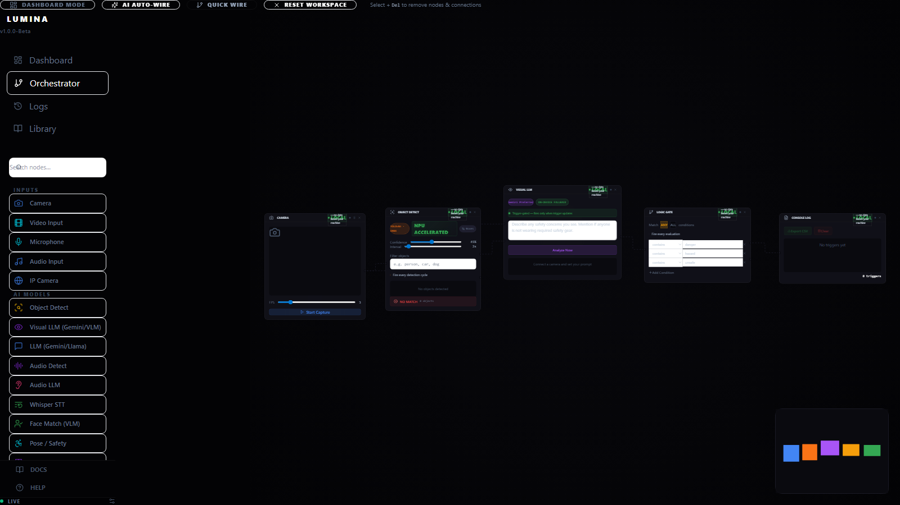
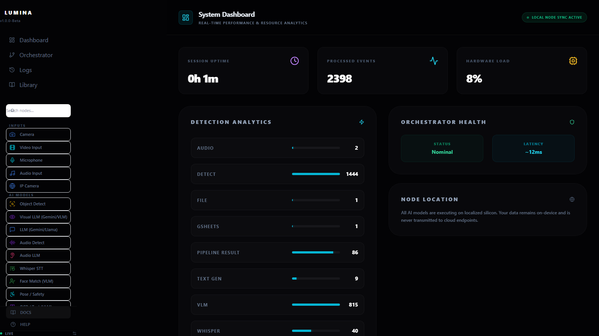
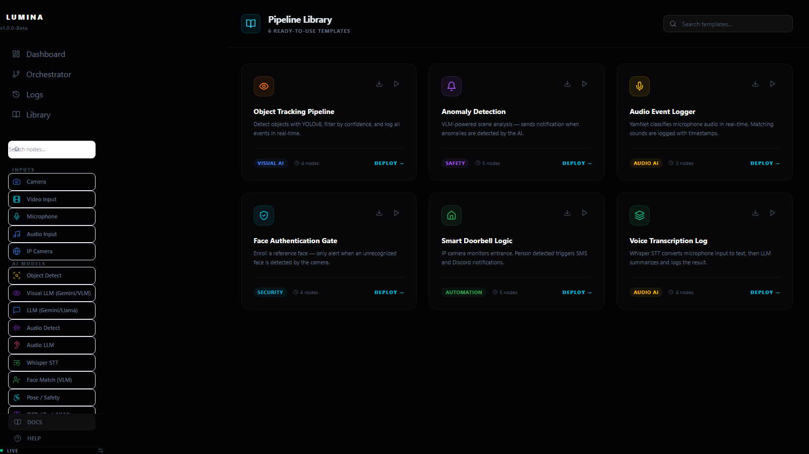
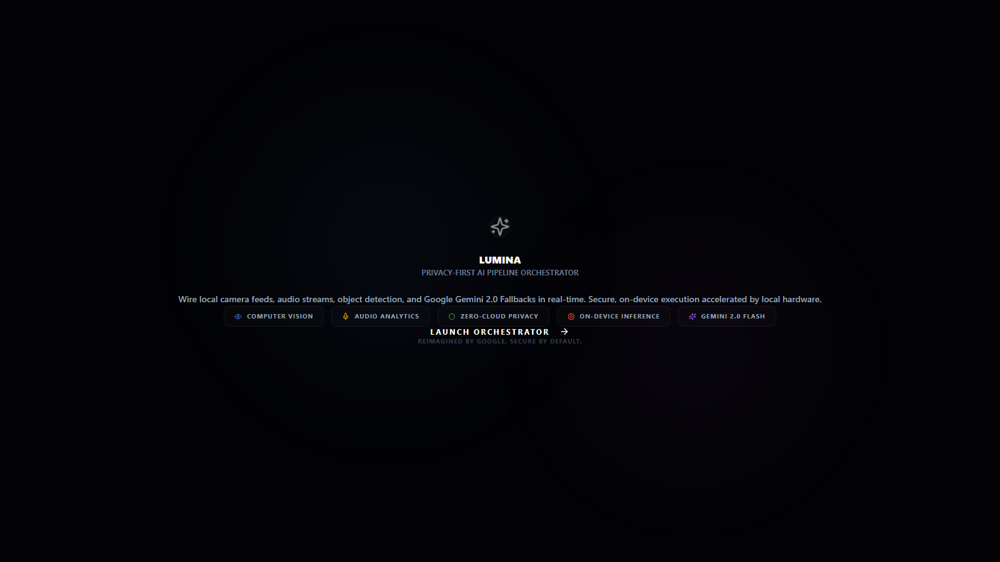

# Lumina

A visual automation builder for AI workflows. You drag nodes onto a canvas, wire them together,
and the pipeline runs — camera and microphone feeds go in, object detection, speech-to-text and
language models process them, and the results trigger emails, Slack or Discord messages, SMS,
MQTT publishes or Google Sheets rows.

Workflows run locally. The vision and audio models execute on the machine through ONNX Runtime,
so camera frames do not leave the device unless a node is explicitly configured to send them.

Finished workflows export to [n8n](https://n8n.io) and [Node-RED](https://nodered.org), so a
pipeline prototyped here can run on automation infrastructure that already exists.

---

## Screenshots

### Orchestrator

Build the pipeline by dragging nodes from the library and connecting them. Here a camera feeds
object detection, a vision language model describes the scene, and a logic gate decides whether
to raise an event.



### Dashboard

Live counts per node type, session uptime, hardware load and orchestrator latency, read from the
event history the backend writes to SQLite.



### Pipeline library

Ready-made workflows to start from — object tracking, anomaly detection, audio event logging,
face authentication, a smart doorbell and voice transcription.



### Landing



---

## What you can build with

**34 node types**, grouped by what they do:

| Group | Nodes |
| --- | --- |
| Inputs | Camera, IP Camera, Video file, Microphone, Audio file, Screenshot |
| Vision | Object detection (YOLOv8), Visual LLM, OCR, Pose / safety, Face match |
| Audio | Audio detection (YAMNet), Audio LLM, Whisper speech-to-text, Gemini Live |
| Language | LLM (Gemini or local Ollama), Tool use |
| Logic | Logic gate, Merge, Debounce, Script |
| Outputs | Email, Slack, Discord, SMS, MQTT, Webhook, Google Sheets, Notify, Speak, Sound alert, File, Log |

Two things make it more than a diagram editor:

- **Describe a workflow in English and it builds it.** The AI engine turns a sentence such as
  *"alert me on Discord when someone without a helmet is detected"* into a node graph, with a
  rule-based fallback when no model is reachable.
- **Auto-wire.** Given a set of unconnected nodes, it infers the sensible connections between them.

---

## Architecture

```
  Next.js + React Flow  ──WebSocket──  FastAPI
  (canvas, dashboard)                  (server.py)
                                           │
                            ┌──────────────┼──────────────┐
                            │              │              │
                      ai_engine.py     vision.py      audio.py
                      LLM, workflow    YOLOv8 ONNX    YAMNet ONNX
                      generation,      OCR, pose,     Whisper
                      auto-wire        face match
                                           │
                                       SQLite (lumina.db)
                                       events, workflows, vault
                                           │
                            export_n8n.py / export_nodered.py
```

The frontend holds canvas state in Zustand and talks to the backend over a WebSocket for live
frames and results, plus **27 HTTP endpoints** for the per-node operations. Secrets for the output
nodes are kept in a local vault rather than in the workflow file.

---

## Running it

**Requirements:** Node.js 18+, Python 3.10+, and a webcam if you want the camera nodes.

```bash
git clone https://github.com/pranayr710/lumina
cd lumina

# frontend
npm install

# backend
python -m venv v
./v/Scripts/python.exe -m pip install -r requirements.txt   # Windows
# source v/bin/activate && pip install -r requirements.txt  # macOS / Linux
```

Create a `.env` from the keys you need — everything is optional, and nodes you have not configured
simply stay inactive:

```ini
GOOGLE_API_KEY=                   # Gemini, for the LLM and visual LLM nodes
LUMINA_USE_OLLAMA_FOR_TEXT=true   # or run language models locally instead
LUMINA_SMTP_USER=                 # Email node
LUMINA_SMTP_PASS=
TWILIO_ACCOUNT_SID=               # SMS node
TWILIO_AUTH_TOKEN=
```

Start both halves:

```bash
npm run backend     # FastAPI on :8000
npm run dev         # Next.js on :3000
```

Then open <http://localhost:3000>. `npm run full-dev` starts the backend, the frontend and the
Electron desktop shell together.

---

## Exporting

A workflow built here can be exported to run elsewhere:

```
POST /api/export/n8n          → n8n workflow JSON
POST /api/export/nodered      → Node-RED flow JSON
POST /api/export/n8n/push     → push straight into a running n8n instance
POST /api/export/nodered/push → push straight into a running Node-RED instance
```

---

## Project layout

```
app/                 Next.js pages — canvas, dashboard, logs, library
components/          React components
  nodes/             one component per node type (34)
lib/                 Zustand stores, capture helpers, WebSocket client, types
server.py            FastAPI app, WebSocket hub, 27 endpoints
ai_engine.py         LLM calls, workflow generation from text, auto-wire
vision.py            YOLOv8 / OCR / pose / face match through ONNX Runtime
audio.py             YAMNet classification and Whisper transcription
export_n8n.py        workflow → n8n JSON
export_nodered.py    workflow → Node-RED JSON
electron-main.js     Electron main process
e2e/                 Playwright tests
```

---

## Tests

```bash
npx playwright test            # end-to-end UI tests
python test_lumina_features.py # backend feature checks
```

---

## Built with

Next.js 14, React 18, React Flow, Zustand, Tailwind CSS, TypeScript, Electron ·
FastAPI, Uvicorn, WebSockets, SQLite, ONNX Runtime, OpenCV, NumPy ·
YOLOv8, YAMNet, Whisper, Google Gemini, Ollama
